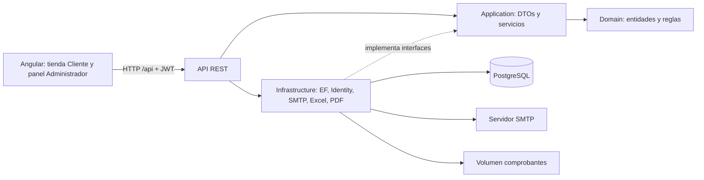
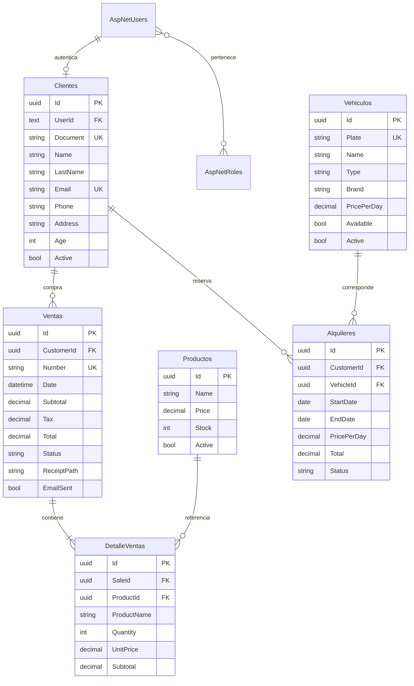
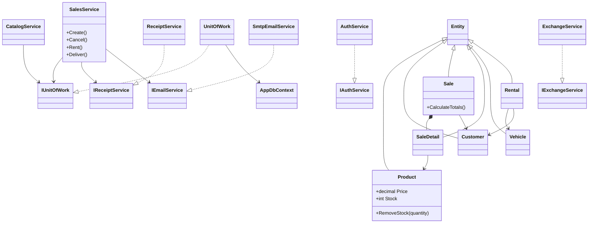
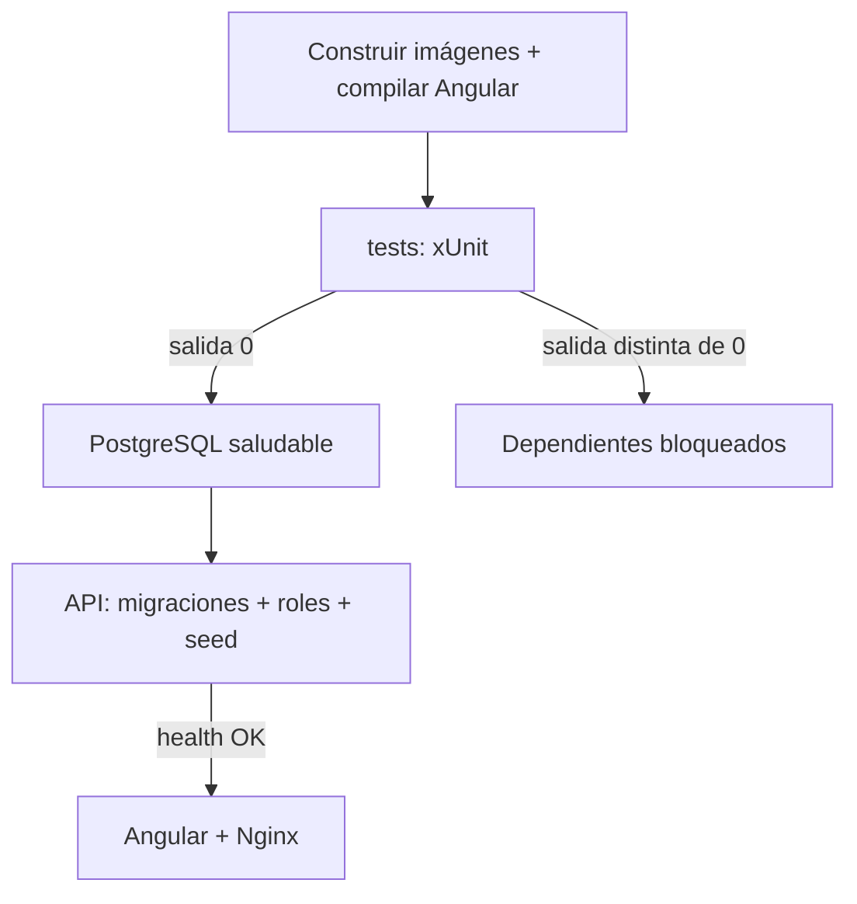

# Arquitectura

## Modelo entidad-relación

Los nombres de tablas son los del documento; los nombres de propiedades del código están en inglés. Los importes históricos y nombres de producto quedan conservados en DetalleVentas. Identity añade sus tablas de claims, tokens, logins y roles mediante la misma migración EF.

## Diagrama de clases

## Arranque

